# Kbootar

Kbootar — messenger for your APIs.

This repo holds releases only — no source code lives here.

## Features

- Request builder — method, URL, headers, params, body (raw, form-data, urlencoded, binary)
- Auth — Basic, Bearer, API key, OAuth2 (client credentials), JWT
- Collections with folders; import from Postman, Insomnia, cURL, HAR; export/import as `.kbtr`
- Environments with variable substitution; multiple workspaces
- Response viewer — status, timing, headers, cookies
- TLS inspection — certificate chain, trust status, self-signed detection; mutual TLS (client certificates)
- Cookie jar; HTTP/HTTPS proxy support
- Remote Executor mode — send requests through a service you run on another machine or network
- Pre-request and test scripts
- History, grouped by host
- Auto-updates

## See it in action

**Send a request**
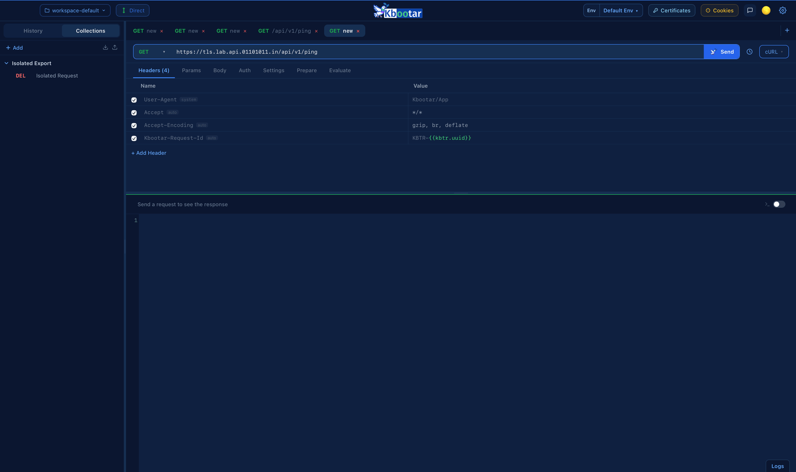

**Import a cURL command**
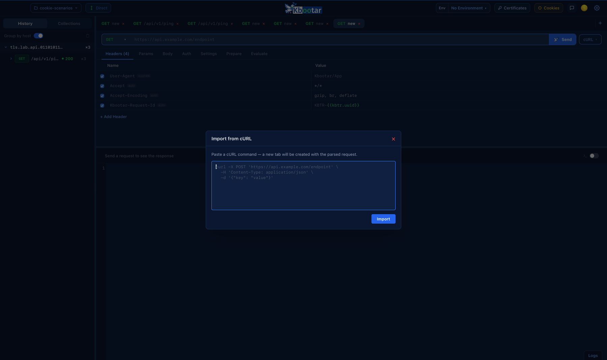

**TLS certificate inspection**
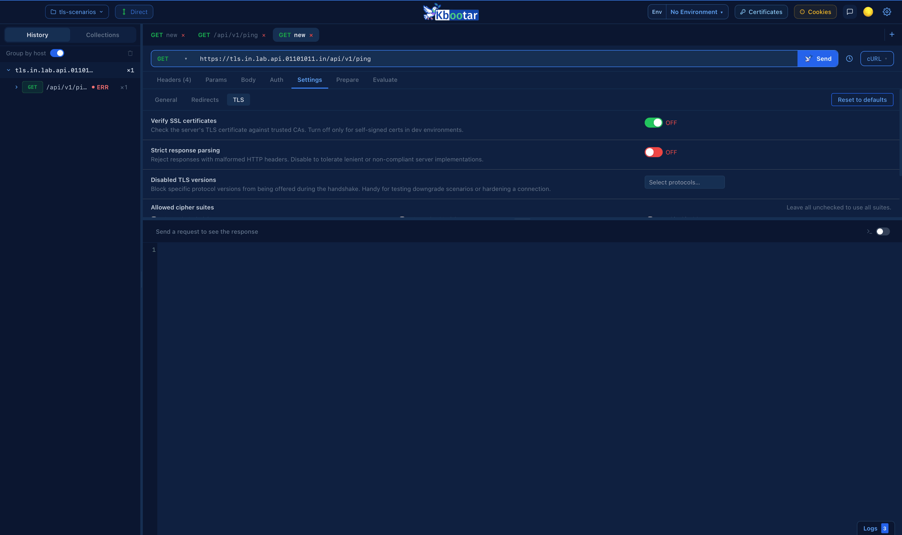

**Switch environments**
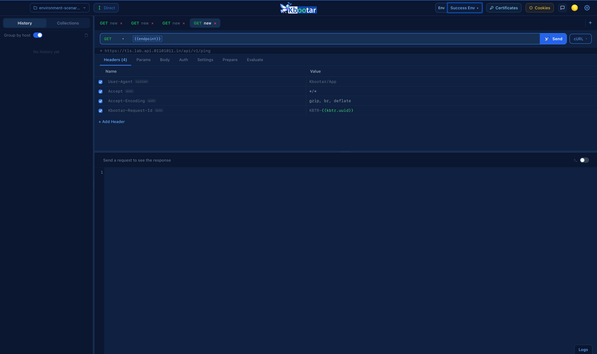

**Organize requests into collections**
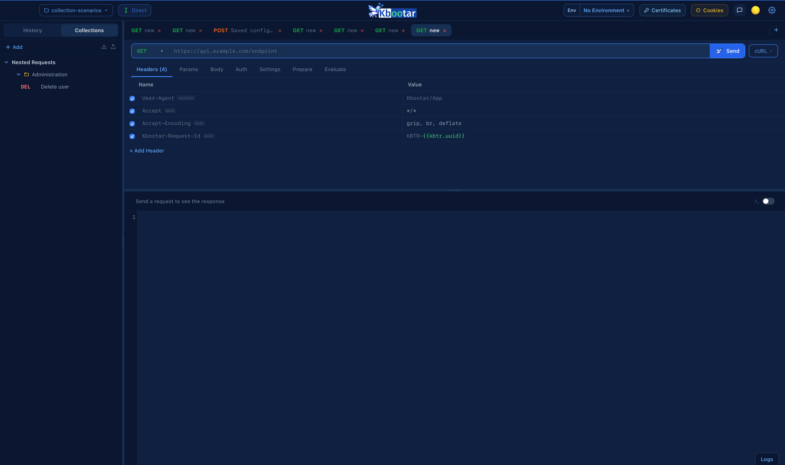

**OAuth2 client credentials — fetched once, cached after**
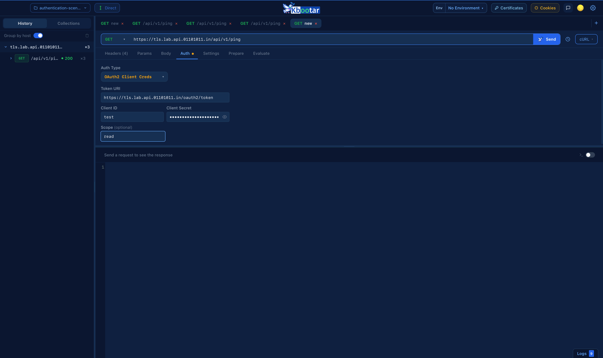

**Cookie jar — captured automatically, reused automatically**
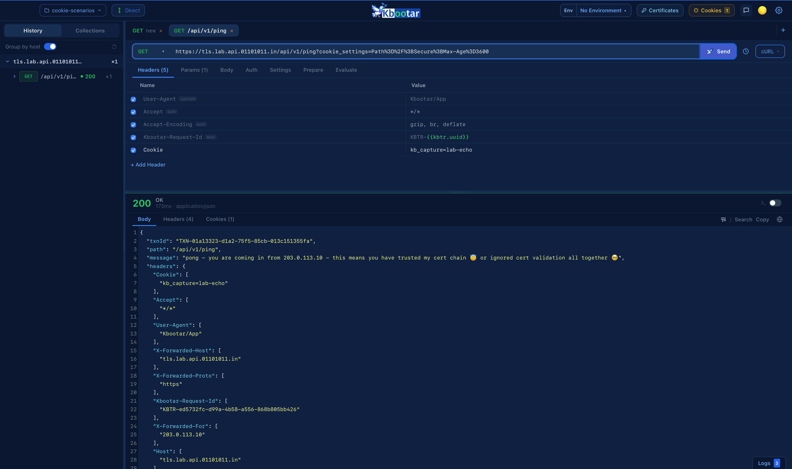

**Request history, grouped by host**
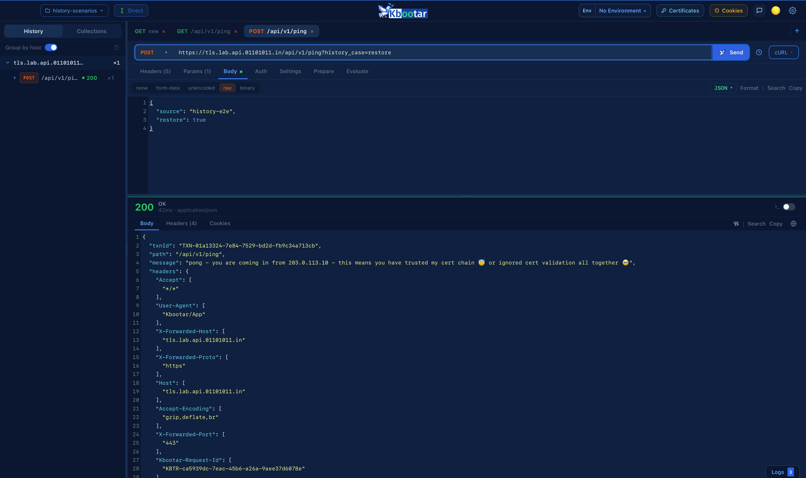

**Prepare and Evaluate scripts — mutate the request, assert on the response**
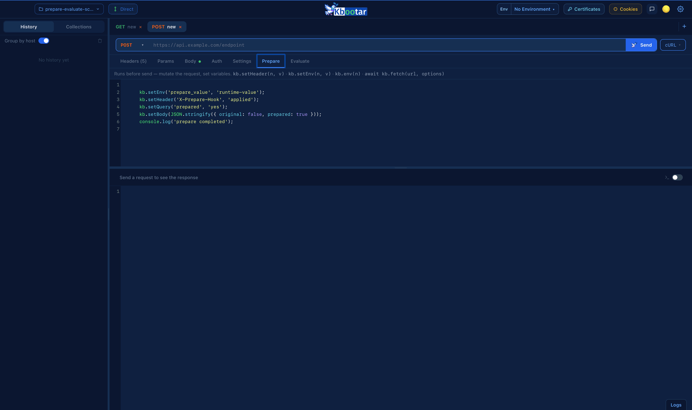

**Export and import collections as `.kbtr`**
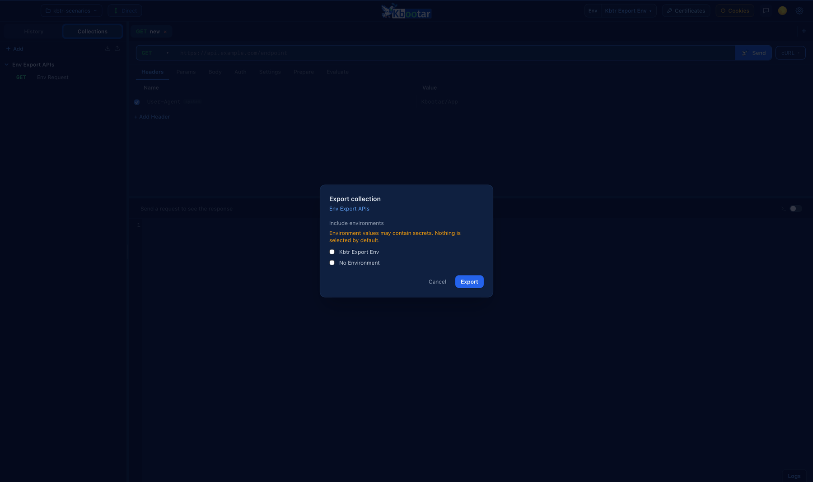

**Response viewer — raw/preview toggle and search**
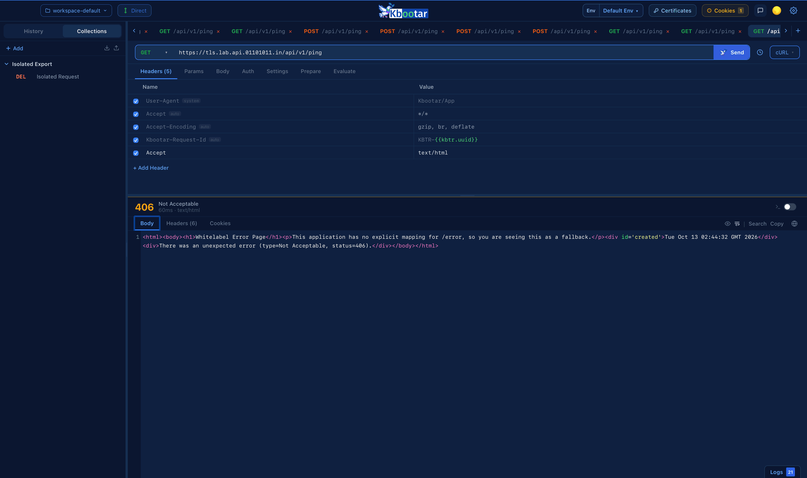

## Remote Executor

In Remote mode the app sends each request through a service you run, so the call leaves from that network instead of your machine. That helps when the target is only reachable from a VPN, a corporate network, or a host that holds the private CAs and client certificates.

[kbootar/remote-executor](https://github.com/kbootar/remote-executor) has the OpenAPI spec for that service and a Spring Boot reference implementation. To write your own in any language, implement `POST /api/execute` as described in the spec.

## Download

| | macOS (Apple Silicon + Intel) | Windows (x64) |
|---|---|---|
| **Beta** — available now | [Download .dmg](https://github.com/kbootar/app/releases/download/latest-beta/kbootar-beta_universal.dmg) | [Download .exe](https://github.com/kbootar/app/releases/download/latest-beta/kbootar-beta_x64-setup.exe) |
| **Stable** — coming soon | Coming soon | Coming soon |

The beta links always point to the newest beta build. Earlier builds are on the [releases page](https://github.com/kbootar/app/releases), marked Pre-release.

macOS builds are signed and notarized by Apple, so there is no security warning on first open.

Each release also has a `kbootar-beta_<version>_universal.app.tar.gz`. Only the in-app auto-updater uses it; don't install it by hand.

## Channels

- **Beta** (`kbootar Beta.app` on macOS) — available now. New features land here first, so it can be less polished. It installs side by side with stable.
- **Stable** (`kbootar.app`) — coming soon, for everyday use once beta has settled.

Installed builds update automatically — checked every 2 hours, whenever the app regains focus, or on demand from the app's "Check for Updates…" menu item.

## Feedback & issues

- In-app: the feedback button in the header
- Here: [open an issue](https://github.com/kbootar/app/issues)
